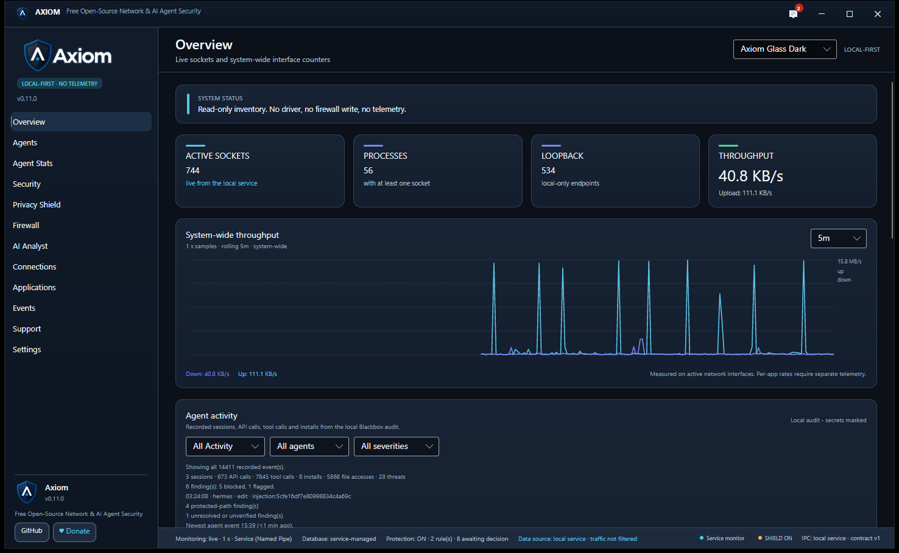

# Axiom

**Free Open-Source Network & AI Agent Security**

**Version:** 0.57.0 | **Repository:** https://github.com/a-51-50/Axiom | **License:** GPL-3.0-or-later

> The repository is private during active development. The source license remains
> GPL-3.0-or-later; public source availability will be confirmed before a public release.

> **Development build - use at your own risk.** Axiom is under active development and may contain
> defects, incomplete features or regressions. Firewall changes can interrupt connectivity, DNS
> changes can break name resolution, and agent hooks can block tools or files. Do not rely on it as
> your only security control. Where possible, test firewall and DNS changes in a VM, keep backups
> and keep a recovery path.

> **What Axiom is.** An agent-first endpoint security application: it protects the computer from the
> agents that run on it and protects those agents from the world they read, using Agent Blackbox
> hooks, an honest enforcement receipt, an OS network boundary and a verifiable DKG memory. See
> [docs/AXIOM_OVERVIEW.md](docs/AXIOM_OVERVIEW.md).

## Project Leadership & Founding Team

**Axiom** is an independent, open-source network and AI-agent security project developed by its
founding team.

**Founder & Original Creator**

[@a-51-50](https://github.com/a-51-50)

Original project creator, initiator and developer of the initial Windows implementation.

**Co-Founders & Core Maintainers**

[@dreddster](https://github.com/dreddster)

[@brxtrac](https://github.com/brxtrac)

Members of Axiom's founding development team, contributing to its long-term technical direction,
cross-platform development and maintenance. The team is expanding Axiom across Windows, Linux and
macOS; platform-specific responsibilities and actual implementations are documented separately as
development progresses.

**Canonical upstream:** [a-51-50/Axiom](https://github.com/a-51-50/Axiom)

**Affiliation:** [OpenDKG](https://github.com/OpenDKG)

Project leadership titles do not automatically transfer repository or intellectual-property
ownership.

See [AUTHORS.md](AUTHORS.md) and [Repository Stewardship](docs/REPOSITORY_STEWARDSHIP.md) for
additional information.

> These public credits do not replace any applicable signed founder or contributor agreements.


Axiom is a local-first Windows network monitor, firewall policy manager and optional AI-agent
protection console. It shows which applications use the network, which endpoints they talk to, and what
happened over time. It manages only its own rules in the built-in Windows Firewall; Windows remains
the enforcement authority. Core functions need no account or cloud connection; Axiom has no advertising or its own analytics
telemetry. Optional AI, reputation, Blackbox and DKG features can contact external services or
network peers when deliberately enabled.

Axiom brings together four surfaces:

- **Network visibility and history** for TCP/UDP IPv4/IPv6 sockets and applications.
- **Axiom Shield** — one switch that installs the elevated local service and turns the ask policy
  on: every new outbound application waits for Block or Allow, and blocks are Axiom-owned Windows
  Firewall rules with read-back verification and recovery.
- **Local privacy controls** including Privacy Shield DNS filtering and a read-only AI analyst.
- **Agent protection** through Blackbox-compatible lifecycle hooks, an agent network lockdown
  (localhost only) and a local audit view.

Blackbox and OriginTrail DKG are optional. Axiom works without either; when present, they add
agent-level guardrails and signed threat-intelligence context respectively.

## Current release and quick links

**Current development release:** [0.32.0](docs/RELEASES/0.32.0.md), 15 November 2026. Axiom's **core protection is local-first**: Windows Firewall rules, stored DNS policy and network monitoring do not require Blackbox or DKG. Optional integrations can sync or share data externally when configured and approved.

> **Version numbering:** development builds were previously numbered `0.10.x`. A short reset produced `0.2.0` and `0.3.0`, but GitHub orders releases by semantic version, which hid them below `0.10.25`. The public release line resumed at `0.11.0` and continues through `0.32.0+`; `0.2.0`/`0.3.0` remain historical snapshots. `scripts/build-release.ps1` refuses a version that is not greater than the highest existing `v*` tag.

- [Install and first-run modes](docs/INSTALL.md) — core vs Complete setup and required privileges.
- [Architecture](docs/ARCHITECTURE.md) — Avalonia UI, local service, Windows Firewall and optional components.
- [Security model](docs/SECURITY_MODEL.md) — what stays on-device, what can leave and where protection can fail open.
- [Threat intelligence lifecycle](docs/THREAT_INTELLIGENCE.md) - Axiom sightings, Blackbox reports, community sharing, verified graph and SWM/VM provenance.
- [Appearance and Axiom Glass](docs/APPEARANCE.md) - themes, current glass styling and what is not yet implemented.
- [Full historical changelog](docs/CHANGELOG.md) — release-by-release detail from earlier README versions.

> **Do not equate a locally connected module with fresh DKG synchronization, or a signed community report with a verified threat.** Agent hooks can fail open when their local guard is unavailable. A DNS fallback can preserve connectivity while bypassing Privacy Shield filtering.

## What it covers

### Per-application network visibility

- TCP and UDP sockets for IPv4 and IPv6, read from the Windows IP Helper owner tables.
- Process attribution by PID, executable name and resolved path; unresolved or protected processes
  are marked as partial instead of being guessed.
- Local and remote endpoints, connection state, direction, loopback detection and the first time a
  flow was observed.
- **Group by app** with cumulative TCP megabytes sent and received per application, the realtime
  rate from the latest poll, and sorting by total, sent or received traffic in either direction.
  TCP totals come from Windows extended TCP statistics; UDP and flows shorter than one poll are
  marked as not measured instead of guessed.
- A sortable, filterable, virtualized table that stays responsive with hundreds of processes and
  thousands of rows.

### Agent protection

- Detects supported coding-agent workspaces and installs only Axiom-managed hook files. Existing
  user-authored hooks are preserved and backed up.
- Supported harnesses: **OpenCode/OpenChamber, Codex, Claude Code, Cursor, GitHub Copilot CLI,
  Gemini CLI, Windsurf Cascade, Cline, ZCode and DeepSeek Harness**.
- **Agent sessions** include Claude Code, Codex and OpenCode/OpenChamber metadata. The OpenCode
  database is read-only; a session is **live** when its host process runs or its data changed in the
  last five minutes, and raw session ids stay hashed.
- Uses five lifecycle points where the host supports them: session start, user prompt, pre-tool,
  post-tool and stop. ZCode uses its user-level `hooks.events`; DeepSeek Harness uses its Claude
  Code-compatible bridge.
- The **Agents** page separates `HOOKED`, `CONNECTED`, `VERIFIED`, `TRUST REQUIRED`, `AUDIT ONLY`
  and `DEGRADED` states. An installed hook is never presented as proof of runtime blocking.
- Agent activity is loaded from the local Blackbox audit store, with a separate bounded Axiom hook
  evidence feed. Sessions, API steps, tool calls, package installs, file access and threats can be
  filtered and copied from the UI.
- The **Verified graph sync** card mirrors the local dashboard's state machine: downloaded versus
  compiled assets, triples, verified rules and verified-answer lookup health. It draws the verified
  threat graph natively from the same local `/api/graph` data, grouped by the dashboard's categories
  and coloured by severity. **Sync now** triggers the dashboard's own `POST /api/sync`; Axiom does
  not run a second DKG sync loop. **Auto-sync**, off by default, requests incremental catch-up approximately every 15 minutes when enabled, so existing local assets stay in place and new graph entries are fetched without
  repeating the full download. Missing values stay unknown and an offline node is never shown as a
  clean graph.
- Agent configuration, sessions and databases are fingerprinted during install, hook repair and
  uninstall. Unexpected deletions or edits are reported and, where possible, restored.
- **Codex still requires its own `/hooks` trust approval.** Axiom installs the definitions but does
  not bypass, forge or pre-approve Codex trust. DeepSeek Harness also requires the official
  `@deepseek-ai/dsh-hooks-claude-code` bridge package in a DSH profile.

### Local history

- A local SQLite database stores connection metadata with UTC timestamps.
- Search by application, path, remote endpoint or PID, with time ranges from minutes to days.
- Paging, retention limits and CSV export to a path the user chooses.
- Database corruption is detected and the damaged file is preserved before a clean database is
  created.

### Firewall policy management

- Rules are path-scoped and bound to a direction and Windows network profile.
- Every rule owned by the application has a deterministic name,
  `Axiom::{rule-id}::{OUT|IN}`, so it can be found and removed without touching anyone
  else's rules.
- A rule is reported as applied only after an OS read-back of the created rule; an external block or
  Group Policy remains authoritative.
- The application never performs wildcard deletes, never resets the Windows Firewall and never
  disables Defender, BFE or another product's filters.
- Write operations stay off until consent. A **complete installation** enables **Axiom Shield**
  during setup: it registers and starts the Axiom Windows service (one administrator approval) and
  then may create or remove `Axiom::{id}::{OUT|IN}` rules. A **partial installation** leaves Shield
  off until you enable it. Every change is confirmed, read back and audited; disabling the shield
  removes every Axiom-owned rule.

### Privacy by default

- All processing is local by default. The standard build makes no outbound network call unless the
  optional AI Analyst, reputation feed or another optional module is explicitly enabled.
- No mandatory Axiom account, Axiom-hosted analytics, advertising or data sales. Optional DKG/Blackbox synchronization involves external peers, and optional cloud AI/reputation integrations may make network requests.
- Local storage includes connection metadata, locally blocked DNS history, firewall audit records, AI findings and optional Blackbox-related state. Allowed DNS browsing history is not stored as blocked-event history; packet payloads and TLS contents are not captured. The optional AI evidence package includes sanitized process metadata and a local flow baseline. See the detailed [data and egress inventory](docs/SECURITY_MODEL.md).
- Optional intelligence modules (file reputation, threat feeds, DKG/Blackbox) are separate, off by
  default, and never sit on the per-connection enforcement path.

## Optional modules

The Standard build is the local monitor and firewall policy manager. Everything in this section is
an optional, separately enabled module: none of it is required, none of it starts a background
process while disabled, and none of it sits on the per-connection firewall path.

The Security page probes a running Blackbox dashboard or DKG node on loopback and reports
`CONNECTED`, `NOT RUNNING` or `UNAVAILABLE`. The Install buttons launch the official third-party
installer only after an explicit confirmation; nothing runs silently. Setup steps are in
[Optional integrations](docs/INTEGRATIONS.md).

### Privacy Shield

A local DNS filter with Basic/Balanced/Strict profiles, custom allow and block lists and a loopback
resolver. A **complete installation** turns it on with the Balanced profile and all five sources; a
partial installation leaves it off. It never changes adapter DNS settings automatically; manual
adapter configuration and rollback are documented in [Privacy Shield](docs/PRIVACY_SHIELD.md).
Five HTTPS sources are catalogued with their licenses: HaGeZi Multi PRO and OISD Big (GPL-3.0),
WindowsSpyBlocker (MIT), and The Block List Project Ads/Tracking (Unlicense). They are downloaded at
runtime, not bundled; no separate approval is required beyond the license and attribution terms.
Counters are in memory; a bounded local history of blocked domains/categories/timestamps and the
requesting application (when Windows exposes it) is kept and can be cleared. Recent blocks refresh
every 2 seconds and offer Allow/Block actions. Allowed queries are never stored. DoH/DoT/DoQ,
hardcoded IPs and VPN traffic are not covered. Optional catalogued HTTPS sources are bounded and
atomically updated; VM test coverage is tracked in
[the VM test plan](docs/PRIVACY_SHIELD_VM_TEST_PLAN.md).

### AI Security Analyst

An optional, default-disabled read-only analyst for the current bounded connection snapshot. The
primary seamless provider uses the **OpenChamber/OpenCode CLI already signed in on the PC**
(`opencode://local`), so no separate local inference server is needed; OpenAI-compatible, OpenAI,
Anthropic, DeepSeek and Z.ai providers remain available. API keys are protected with Windows DPAPI,
local paths are redacted by default and only bounded structured findings are stored. The analyst
cannot change firewall rules, execute commands or read arbitrary files. See
[AI Security Analyst](docs/AI_ANALYST.md).

### File tracker and local reputation

- Watches only the folders the user selects (for example Downloads, optionally Desktop), never the
  whole disk. The Security page also has an on-demand **Scan** action that hashes a chosen folder
  locally with SHA-256.
- Debounces file events, computes SHA-256 in the background with size and I/O limits, and reads
  Authenticode signer metadata for PE files.
- Shows local provenance, first/last seen and an explicit `unknown` result. It never uploads,
  deletes or quarantines a file automatically, and never turns an unknown hash into "malware".

### External reputation (VirusTotal gate)

- The default build sends no file, URL, hash or IP to VirusTotal.
- The Security page has a **Setup** action for an opt-in, hash-only provider. The API key is stored
  with Windows DPAPI for the current user; only a SHA-256 is sent when you press **Check**.
- The safe fallback is manual: copy the SHA-256 or open the VirusTotal website in the browser.
- A provider-neutral adapter may be added only after the concrete use is confirmed to be allowed by
  the provider. Such an adapter would be opt-in, use the user's own key, perform hash-only lookups,
  respect the published rate limits, cache results and never auto-upload files.
- A VirusTotal result is one source with a timestamp, not a verdict.

### Blackbox (Umanitek Guardian Agent Blackbox)

Blackbox is an optional local agent-safety layer. Axiom does not reimplement it: Axiom installs thin
adapters and calls the guard that Blackbox exposes from its Hermes plugin environment.

- The Blackbox dashboard and guard stay on loopback (`127.0.0.1:9700`); Axiom never opens it to the
  network. Axiom does not run Hermes, OpenClaw, Node or Docker in the background. A short-lived
  Python adapter runs only when a supported agent hook fires; if Blackbox is absent, it fails open.
- Axiom's OpenCode/Codex/Claude/ZCode/DeepSeek and other adapters send **tool and lifecycle events**
  to the local Blackbox guard. Blackbox evaluates the policy and records locally redacted audit
  events; Axiom shows those events on the Agents and Overview pages.
- In **Audit** mode Blackbox records findings without blocking. In **Block** mode it rejects
  confirmed threats according to its configured severity and policy. Axiom can switch the mode in
  `~/.hermes/config.yaml` without reinstalling.
- Agent hooks are **fail-open**: if the guard, Python runtime or hook process fails, the agent is not
  made unusable. That is a deliberate availability trade-off and is shown as `DEGRADED`, not
  "protected".
- Blackbox is third-party software. No official partnership or endorsement is implied. Codex trust
  remains a Codex-owned decision.

### OriginTrail DKG V10

OriginTrail's Decentralized Knowledge Graph (DKG) is an optional knowledge and provenance layer. It
is not a firewall engine and is not required for local monitoring or enforcement.

- Core Windows Firewall policy and locally stored DNS lists do not require a wallet, TRAC, token, live DKG node or VM publication to work.
- An optional local DKG node and Blackbox dashboard can be installed/started explicitly. The dashboard exposes a locally synchronized verified graph and can request incremental sync; offline cached data is last-known evidence, not a fresh consensus check.
- Axiom does not yet perform general verified/community graph lookups on every connection or automatically turn graph sightings into Windows Firewall rules.
- The user may explicitly submit normalized threat reports through Blackbox, but Axiom does not directly publish paid VM assets or assume TRAC/gas costs. See [Threat intelligence](docs/THREAT_INTELLIGENCE.md).
- DKG is never on the per-flow Windows Firewall enforcement path.
- Signed data is evidence, not automatic truth. Publishing to a test network is a separate,
  explicit action with its own budget and approval.

**How they fit together:** Blackbox is the local **agent guard and audit trail**; DKG is the
optional **verified knowledge layer** that can supply signed rules and threat context. They are
independent: Axiom works with neither installed, a DKG outage does not disable the firewall, and an
offline Blackbox does not stop local monitoring.

### Threat sharing and community intelligence

Axiom can offer suspicious public indicators for optional sharing through Blackbox. Candidates are stored locally and **are not sent until you choose Share or Send now**. Community reports do not automatically create firewall rules. Axiom can display the synchronized verified threat graph when Blackbox is available.

Shared Memory is intended for time-limited reports; Verifiable Memory is designed for independently verifiable, longer-lived publications. Axiom does not publish directly to paid VM or require users to pay TRAC/gas fees. Learn how reports, identity and offline caching work in [Threat intelligence](docs/THREAT_INTELLIGENCE.md).

The optional community feed can display reputation evidence from a chosen HTTPS source. The bundled starter feed includes a test indicator only; it is not live threat intelligence.

### Privacy and safety of optional features

- Optional network integrations require configuration and, where applicable, explicit consent.
- Local Windows Firewall and DNS protection use their own stored policies rather than querying a remote service for each connection.
- A reputation result has a source and age; unknown does not mean safe.
- Review the privacy terms of each third-party provider before enabling it.

## How it works

```text
Unprivileged Avalonia UI (WPF fallback retained in source)
   │  local Named Pipe (explicit ACL, client SID check)
   â–¼
Windows Service
   ├─ IP Helper inventory and process attribution
   ├─ bounded aggregation and local SQLite history
   └─ owned-rule coordinator → Windows Firewall
```

- The UI never runs as administrator and never receives a generic shell or "execute" command.
- The service is the privileged boundary. It validates every request, enforces message limits and
  keeps monitoring running when the UI is closed.
- The local pipe is not reachable over SMB: network, anonymous and guest logons are denied.
- Byte accounting uses platform counters where they exist; values carry a source and a quality flag,
  and partial data is shown as partial rather than as an exact measurement.

## Security and privacy

- **Least privilege:** the UI is `asInvoker`; only the service can eventually change firewall state.
- **IPC:** explicit pipe DACL, client SID verification, typed commands, request size limit, rate
  limit, idle timeout and no generic execution endpoint.
- **Firewall safety:** only owned rules, deterministic names, read-back verification, targeted
  removal and a documented recovery path.
- **Data at rest:** bounded local SQLite network metadata plus separate blocked-DNS history, audit, findings and opt-in module state; no packet payload capture; credential storage and optional egress are detailed in the security model.
- **Honest status:** the interface distinguishes observed data, estimates, partial attribution,
  unavailable adapters and external policy conflicts. It never shows "Protected" unless the OS
  result is verified.
- **Supply chain:** pinned NuGet versions, committed lock files, warnings-as-errors and a generated
  third-party license inventory.

## Platform and requirements

- Windows 11 x64, or Windows 10 x64 with best-effort support.
- The published Windows installer is self-contained; installing the core app does not require a separate .NET runtime.
- Core monitoring runs locally. Turning on Axiom Shield or changing an adapter's DNS settings can require Windows administrator approval.

### Installation (core per-user setup; optional modules require additional consent)

The release ZIP contains **`Axiom-Setup.exe`**. Double-click it, choose the agent-hook scope
(Complete or Partial) and click **Install Axiom**. The setup is a single self-contained
executable with the desktop and local service payload embedded; it installs under
`%LOCALAPPDATA%\Programs\Axiom`, creates a Start Menu shortcut and starts the app. No .NET
runtime, Windows service registration, firewall change or elevation is involved.

The desktop starts the bundled local service automatically. VirusTotal remains optional; its API
key is configured later on the Security page.

**Complete installation** also runs the official Blackbox and DKG installers, starts their local
services and installs agent hooks after Blackbox is ready. Those third-party installers may download
large packages, require network access and show their own prompts/terms. **Partial installation**
installs only core Axiom and leaves Blackbox, DKG, OpenCode, OpenChamber, Codex, ZCode and DeepSeek
Harness files unchanged. Axiom also provisions Axiom-managed hooks for detected harnesses once per
build at startup, preserving user-authored hooks. Codex still requires its own one-time `/hooks`
trust review.

For installation and recovery details, see [Installing Axiom](docs/INSTALL.md). A core-only Microsoft Store package, where offered, excludes Blackbox/DKG installation and third-party agent hooks.

## Documentation

- [Install and first run](docs/INSTALL.md)
- [Privacy Shield and DNS filtering](docs/PRIVACY_SHIELD.md)
- [Blackbox, DKG and optional integrations](docs/INTEGRATIONS.md)
- [Threat sharing, SWM and VM](docs/THREAT_INTELLIGENCE.md)
- [Security and privacy](docs/SECURITY_MODEL.md)
- [Firewall recovery](docs/FIREWALL_RECOVERY.md)
- [AI Analyst](docs/AI_ANALYST.md)
- [Release readiness & security validation](docs/validation/RELEASE_READINESS_MATRIX.md)
- [Historical changelog](docs/CHANGELOG.md)
- [Licensing](docs/LICENSING.md)

## License and copyright

Copyright (C) 2026 The Axiom contributors.

Axiom is an independent open-source project affiliated with the [OpenDKG initiative](https://opendkg.org).

The desktop application, the Windows service and the core libraries are licensed under
**GNU GPL v3.0 or later**. See [`LICENSE`](LICENSE) for the full text and [`NOTICE`](NOTICE) for the
copyright and grant. Third-party components and their licenses are listed in
[`THIRD_PARTY_NOTICES.md`](THIRD_PARTY_NOTICES.md); names and logos are covered by
[`TRADEMARKS.md`](TRADEMARKS.md). The roles of creators, copyright holders, maintainers and
contributors are described in [`AUTHORS.md`](AUTHORS.md).

The installed application shows the same information under **Settings → About Axiom**, including the
full GPL text, the notice, the third-party list and the source repository. Those documents are
embedded in the application, so they remain readable offline.

Contributions are accepted under the same license with a Developer Certificate of Origin
(`git commit -s`); see [`CONTRIBUTING.md`](CONTRIBUTING.md). Security reports go through the private
advisory process described in [`SECURITY.md`](SECURITY.md). Licensing decisions, dependency
compatibility and the rules for optional integration modules are documented in
[`docs/LICENSING.md`](docs/LICENSING.md) and
[`docs/ADR/0005-license-gpl-3.0-or-later.md`](docs/ADR/0005-license-gpl-3.0-or-later.md).
